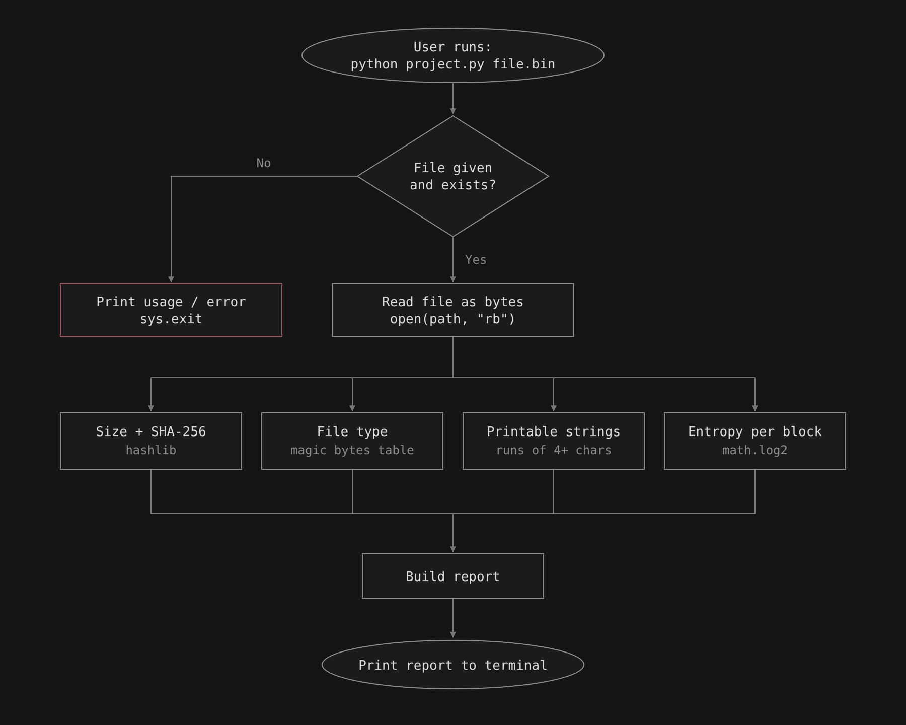

# fwtriage
A Python command-line tool that triages binary and firmware files: it shows their real file type, SHA-256 hash, readable strings and an entropy map.

## Why
I have always been interested in reverse engineering, firmware and embedded security, and I see it as one of the most promising fields to learn. Device security is also becoming a legal requirement: since September 2026, the EU Cyber Resilience Act requires makers of connected devices to report actively exploited vulnerabilities, with full rules from December 2027. 
fwtriage is my first step: a small tool that does the first check every firmware analysis starts with.

## Planned features
- **File type detection**: identifies the format from the first bytes (magic bytes), even if the file name is wrong
- **SHA-256 fingerprint**: a unique hash to check that a file is exactly the one you expect
- **Readable strings**: finds text hidden inside binary data, like versions, URLs and error messages
- **Entropy map**: measures how random each block of bytes is, to show which parts are text, code, or compressed/encrypted data

## How it will work

   
## Status
Work in progress. CS50P final project.

## Usage
Coming soon.
