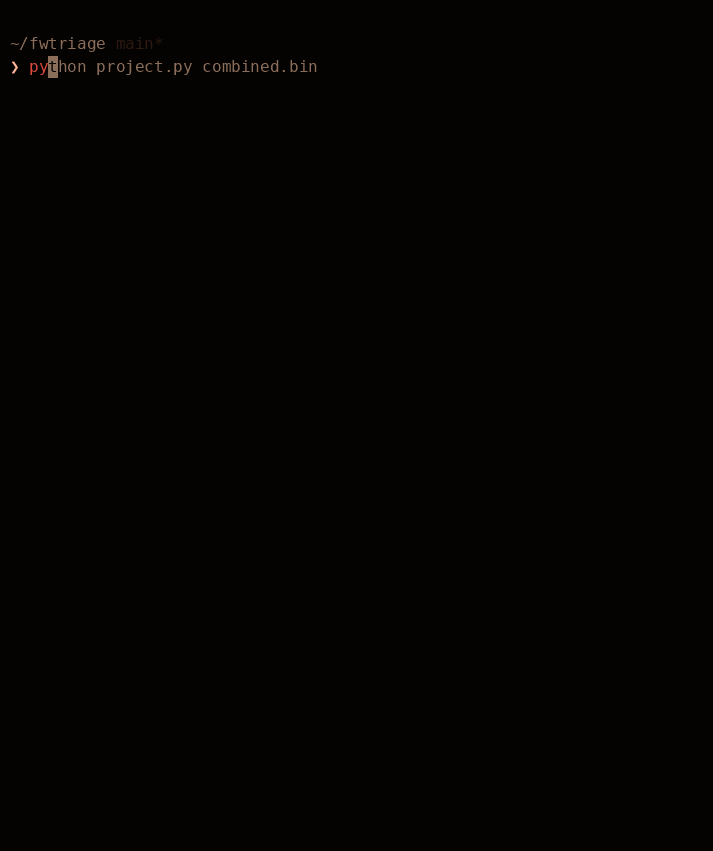

<h1 align="center">fwtriage</h1>

<p align="center">
  A command-line tool for inspecting unknown binary files.
</p>

<p align="center">
  
  
  
</p>

<p align="center">
  <a href="#features">Features</a> •
  <a href="#installation">Installation</a> •
  <a href="#usage">Usage</a> •
  <a href="#limitations">Limitations</a> •
  <a href="docs/README.md">Documentation</a>
</p>

<p align="center">
  
</p>

## Overview

`fwtriage` is a learning project for quickly inspecting unfamiliar binary files. It brings together several basic analysis techniques in one command: file signature detection, readable-string extraction, entropy analysis, and embedded-file signature scanning.

The project was built to explore how tools such as `binwalk` work by implementing some of the underlying ideas.

## Features

- **File type detection** — checks the file's magic bytes against known signatures.
- **String extraction** — finds readable ASCII sequences in the file.
- **Entropy analysis** — calculates entropy for the whole file and for 256-byte chunks to help highlight regions that may be compressed or encrypted.
- **Embedded-file scanning** — searches for known file signatures inside the input file.

## Installation

```bash
git clone https://github.com/LevXddd/fwtriage.git
cd fwtriage

python -m venv .venv
source .venv/bin/activate
pip install -r requirements.txt
```

## Usage

Analyze a file:

```bash
python project.py /bin/ls
```

Try the included sample:

```bash
python project.py samples/combined.bin
```

The tool reports the detected file type, extracted strings, entropy information, and any recognized signatures. The exact results depend on the input file.

## How it works

`fwtriage` reads the input file and applies several analyses to its bytes:

1. It checks the beginning of the file for known file signatures.
2. It extracts runs of printable ASCII bytes.
3. It calculates Shannon entropy for the whole file and in 256-byte chunks.
4. It scans for known signatures that may indicate embedded files.

See the [documentation](docs/README.md) for explanations of the individual functions.

## Limitations

This is an educational project, not a replacement for mature forensic tools.

- The entropy analysis uses fixed 256-byte chunks. Small chunks can make the threshold noisy, so a score near the current threshold should not be treated as proof of encryption.
- Embedded-file signatures are detected, but the files are not extracted.
- Short signatures can match by coincidence, so a match alone does not confirm that a valid embedded file is present.

## Roadmap

- [ ] Add SHA-256 hashing
- [ ] Add an entropy visualization
- [ ] Extract carved files to disk
- [ ] Revisit the entropy thresholds and chunking strategy

## Alternatives

For real-world analysis, consider established tools such as [`binwalk`](https://github.com/ReFirmLabs/binwalk), `file`, and `strings`. `fwtriage` is primarily a project for learning how some of these techniques work.

## License

This project is licensed under the MIT License. See [`LICENSE`](LICENSE) for details.
