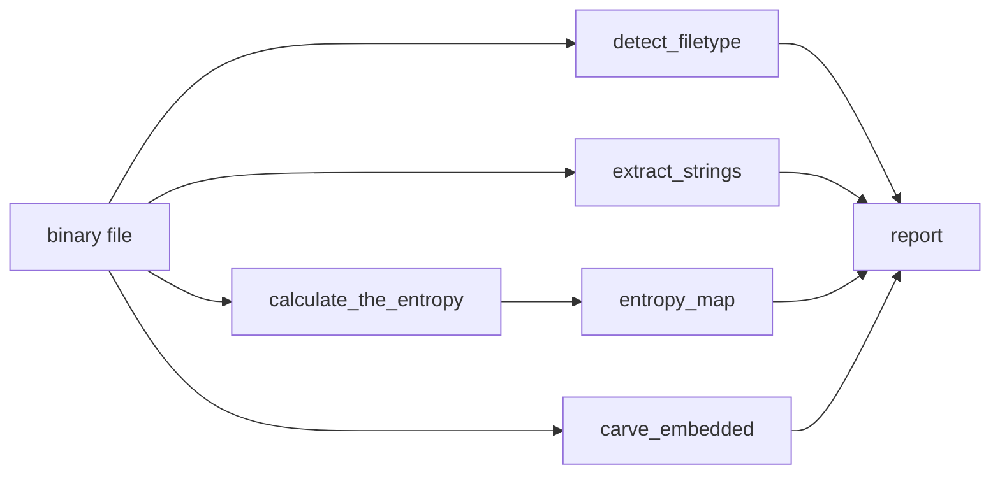

# fwtriage

> [!NOTE]
> **What is it?**
> A command-line tool for triaging unknown binary files: detects file type, extracts hidden strings, measures entropy, and finds embedded files.

## The problem

Imagine someone gives you a file called `firmware.bin`. No extension that helps, no documentation. You open it in a text editor — and see garbage. So what is it? A program? An archive? Is something hidden inside? Is part of it encrypted?

**Triage** is the first look — like in a hospital, where a doctor quickly checks a patient before deciding what to do next. fwtriage does the same for files: in a few seconds it tells you what you are dealing with, so you know where to dig deeper.

## What it answers

| Question | How fwtriage answers | Note |
|---|---|---|
| What type of file is it? | checks the magic number at the start | [detect_filetype](detect_filetype.md) |
| Is there any readable text inside? | pulls out printable ASCII runs | [extract_strings](extract_strings.md) |
| How random is the data? | calculates Shannon entropy | [entropy](entropy.md) |
| Where is the compressed or encrypted part? | entropy for every 256-byte chunk | [entropy_map](entropy_map.md) |
| Are there files hidden inside? | searches for magic numbers everywhere | [carve_embedded](carve_embedded.md) |

Everything is connected in [main](main.md).

## How it works



## Usage

```bash
python project.py firmware.bin
```

The output goes in this order: file type → extracted strings → entropy of the whole file → suspicious chunks → embedded files.

## Why I built it

This is my CS50P final project, and my first step into reverse engineering. Tools like `binwalk`, `file` and `strings` already do this — but I wanted to understand **how** they work inside, so I wrote every part myself.

## Where to start reading

New here? Read in this order:
1. [detect_filetype](detect_filetype.md) — the simplest idea
2. [extract_strings](extract_strings.md)
3. [entropy](entropy.md) — the theory, a bit of math
4. [entropy_map](entropy_map.md)
5. [carve_embedded](carve_embedded.md)
6. [main](main.md) — how it all fits together

## Ideas for later
- [ ] SHA-256 hash of the file
- [ ] Entropy graph with matplotlib
- [ ] C module for speed
- [ ] Actually extract carved files to disk
